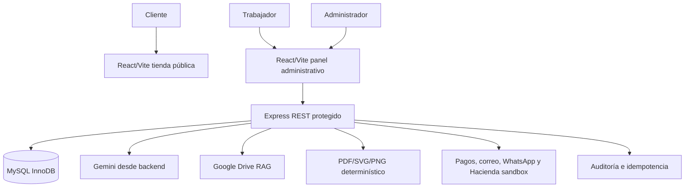

# PROMPT MASTER CODEX — DROP ZONE CR

## Mandato

Actúa como un equipo senior de arquitectura, React/Vite, Node/Express, MySQL, UX/UI, IA, QA y DevOps. Trabaja directamente sobre el repositorio abierto de Drop Zone CR. Evoluciona lo existente; no crees otra tienda ni reemplaces el proyecto.

Antes de modificar:

1. Ejecuta `git status`, revisa la rama, estructura, `package.json`, `.env.example`, rutas, migraciones y pruebas.
2. Lee `docs/PLAN_IMPLEMENTACION_ADMIN.md`, este archivo y la documentación de facturación/IA.
3. Conserva catálogo, imágenes, logo, carrito, comparador, promociones, RAG, panel admin, StaffDesk y APIs que funcionen.
4. No borres datos, no hagas `DROP DATABASE`, no expongas secretos y no publiques ni envíes información real sin autorización.
5. Si falta una credencial o proveedor, crea el adaptador, estado pendiente y prueba sandbox; no declares la integración como real.

## Estado actual que debes respetar

- Frontend: React 19 + Vite en `frontend/`.
- Backend: Node.js + Express en `backend/`.
- Base de datos: MySQL 8 con migraciones idempotentes.
- Autenticación actual: cookie HTTP-only administrativa; no migrar a JWT sin justificarlo y probar compatibilidad.
- Panel administrativo: `AdminPage.jsx` y `StaffDesk.jsx`.
- Gemini: integración backend en `backend/src/gemini.js`, modelo configurable por `GEMINI_MODEL`.
- Google Drive RAG: `drive.js`, `knowledge.js` y tablas de documentos/chunks.
- Facturación actual: documentos comerciales, PDF, vista previa SVG, enlaces privados y WhatsApp Web manual.
- Operaciones actuales: dashboard real, pedidos, historial, envíos, roles, reservas, compras, devoluciones, caja y proveedores sandbox.
- Datos sintéticos: se cargan con `npm run db:seed:demo` y siempre llevan `[DEMO]`.

## Objetivo de producto

Convertir Drop Zone CR en un sistema empresarial conectado:



La verdad de precios, impuestos, pagos, inventario, estados y facturas siempre pertenece al backend y MySQL. Gemini únicamente analiza, resume, extrae o recomienda.

## Prioridades de implementación

### P0 — Datos y seguridad

- Mantener migraciones incrementales e idempotentes.
- Validar entradas con Zod y consultas parametrizadas.
- Usar transacciones y `SELECT ... FOR UPDATE` para inventario, pagos, reservas, caja y recepciones.
- Proteger contra duplicados con claves de idempotencia.
- Auditar actor, fecha, entidad, valores anteriores/nuevos, motivo e IP si existe.
- Aplicar permisos por rol para costos, inventario, reembolsos, facturación, usuarios y archivado.
- Mantener secretos solo en `.env` o el proveedor de secretos.

### P1 — ERP/CRM

Implementa y conecta a MySQL:

- Dashboard: ventas cobradas, pedidos creados, utilidad, ticket promedio, stock bajo, pagos pendientes, facturas rechazadas, clientes nuevos/recurrentes y gráficas reales.
- Pedidos: expediente completo, cliente, líneas con precio histórico, pago, envío, documentos, notas, responsable e historial.
- Inventario: variantes, bodegas, ubicaciones, reservas, disponible, entradas, salidas, traslados, conteos, mínimos, lotes/seriales cuando apliquen.
- Compras: proveedores, órdenes de compra, recepción parcial, diferencias, costos históricos y daños.
- CRM: perfil, historial, segmentación verificable, notas, consentimiento, recordatorios, garantías y devoluciones.
- Pagos/caja: pagos pendientes, parciales, reembolsos autorizados, sesiones de caja, movimientos, cierre y diferencias.
- Devoluciones: casos vinculados al pedido, inspección antes de reponer, resolución y auditoría.
- Papelera: archivado lógico; nunca borrar históricamente sin permiso y auditoría.

### P2 — IA administrativa

Todas las llamadas salen del backend. No expongas `GEMINI_API_KEY` al frontend.

Agentes diferenciados:

1. Invoice AI: campos faltantes, inconsistencias y resumen.
2. Stock AI: reposición explicada.
3. Finance AI: interpretación de utilidad y gastos.
4. Marketing AI: campañas y copys revisables.
5. Customer AI: respuestas sugeridas con datos autorizados.
6. Knowledge AI: RAG con citas válidas y ACL.
7. Analytics AI: tendencias y limitaciones.
8. Compliance AI: riesgos y revisión sugerida.

Cada agente debe tener input/output Zod, límite de tiempo, cuota, auditoría, fuentes, permisos y fallback. Respuesta inválida, timeout o falta de clave debe ser un error recuperable, nunca una operación exitosa.

### Prompt de factura

Usa este prompt en el servicio de revisión, no desde el navegador:

```text
Actúa como asistente administrativo de Drop Zone CR.
Usa exclusivamente el JSON recibido. No inventes ni corrijas silenciosamente
clientes, productos, cantidades, precios, descuentos, impuestos, fechas, moneda,
pagos o estados. Los totales calculados por el servidor son definitivos.

Devuelve únicamente JSON válido:
{
  "summary": "resumen breve",
  "missingFields": [],
  "inconsistencies": [],
  "draftMessage": "mensaje para revisión humana"
}

No afirmes que una factura fue pagada, enviada o aceptada por Hacienda.
Toda recomendación requiere aprobación humana.
```

La imagen/PDF debe generarse con una plantilla determinística desde el JSON validado. Gemini puede revisar o proponer diseño, pero no escribir importes fiscales en una imagen libre. Toda vista debe indicar: `VISTA PREVIA GENERADA — NO ES COMPROBANTE FISCAL`.

### P3 — Integraciones

Preparar adaptadores sandbox para:

- Pasarela de pagos y webhooks firmados.
- Correo transaccional.
- WhatsApp Cloud.
- Hacienda/facturación fiscal.
- Google Drive.
- n8n mediante outbox e idempotencia.

No usar credenciales reales, no enviar mensajes y no emitir documentos fiscales de producción sin autorización explícita y pruebas del proveedor.

## Diseño visual

Conserva la marca y recursos existentes. Usa el estilo tecnológico minimalista de Drop Zone CR:

- Inter como tipografía principal.
- Azul de acción, fondos claros/oscuro administrativo y contraste AA.
- Sidebar, topbar, tarjetas KPI, tablas, filtros, estados, modales y timeline.
- Responsive desde 320 px.
- Estados de carga, vacío, error, sin permisos, éxito y confirmación.
- No agregues botones decorativos: cada acción funciona o explica por qué está deshabilitada.
- Usa las imágenes existentes del catálogo.
- Para diagramas y mockups crea SVG originales o capturas reales de las rutas implementadas. No presentes imágenes falsas como capturas de ejecución.

Wireframe base:

```text
┌──────────────┬────────────────────────────────────────────┐
│ DROP ZONE    │ Buscar  Periodo  Alertas  Perfil            │
│ Dashboard    ├────────────────────────────────────────────┤
│ Pedidos      │ Ventas │ Utilidad │ Pedidos │ Stock crítico │
│ Inventario   ├─────────────────────────┬──────────────────┤
│ Compras      │ Gráfica ventas/costos   │ Recomendaciones │
│ Clientes     ├─────────────────────────┴──────────────────┤
│ Facturación  │ Tablas con filtros, paginación y acciones   │
│ IA           │ Alertas, auditoría y automatizaciones       │
└──────────────┴────────────────────────────────────────────┘
```

## API y base de datos

Usa los patrones existentes y agrega endpoints protegidos para cada módulo. Respuestas coherentes con 400, 401, 403, 404, 409, 422, 429, 500 y 503. Nunca permitas mass assignment.

Para cada migración documenta:

- tablas, claves, índices y relaciones;
- estrategia de compatibilidad y rollback;
- seed sintético reproducible;
- prueba de migración en MySQL local.

Conserva snapshots históricos de precios, costos, clientes y documentos. No recalcules una factura histórica con datos actuales.

## Pruebas obligatorias

Ejecuta desde la raíz:

```powershell
npm install
npm run db:migrate
npm run db:seed:demo
npm test
npm run build
npm run dev
```

Prueba también:

- Login y permisos por rol.
- IDOR entre clientes.
- Inventario concurrente sin negativos.
- Reserva, liberación y recepción idempotentes.
- Pedido y pago sin duplicados.
- Reembolso que no exceda el pago.
- Factura PDF/SVG con totales idénticos al snapshot.
- Gemini con clave válida, clave ausente, JSON inválido y timeout.
- RAG sin fuga entre audiencias.
- Sandbox sin envío externo.
- Papelera y auditoría.
- Escritorio, móvil, teclado y estados de error.

No marques algo como terminado sin evidencia de comando, ruta o prueba.

## Entregables

Mantén actualizados:

- `docs/MATRIZ_CUMPLIMIENTO.md`.
- `docs/PLAN_IMPLEMENTACION_ADMIN.md`.
- `docs/IA_ADMIN_GEMINI.md`.
- DER y diccionario de datos.
- README de instalación y variables.
- OpenAPI o documentación de endpoints.
- workflows n8n sin secretos.
- capturas reales de pantallas verificadas.
- informe de pruebas con fecha y resultado.

Al finalizar cada fase entrega un resumen con archivos modificados, migraciones, comandos, pruebas aprobadas, pendientes, bloqueos y decisiones. No inventes credenciales, ventas, aceptación fiscal, envíos ni resultados de producción.

## Criterio de terminado

El proyecto debe iniciar, migrar, cargar datos demo, compilar y permitir navegar los módulos conectados. Las operaciones críticas deben validar permisos, ser transaccionales, idempotentes y auditables. Gemini debe estar integrado sin exponer secretos y sus recomendaciones deben requerir revisión humana. Las integraciones externas deben quedar claramente etiquetadas como sandbox hasta que existan credenciales y autorización explícitas.

Empieza ahora con diagnóstico y continúa con implementación incremental; no entregues solo recomendaciones.
